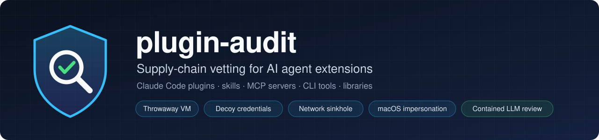
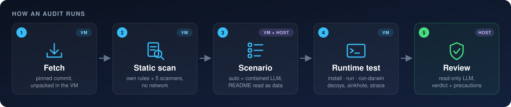
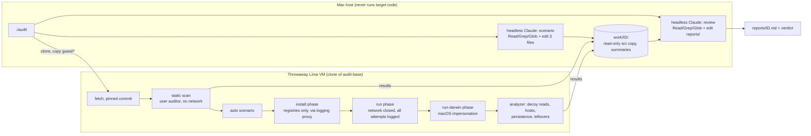

<p align="center"></p>

<p align="center">
  
  
  
  
  
</p>

# plugin-audit: supply-chain vetting for AI agent extensions

```bash
./audit https://github.com/owner/repo        # or an https git URL or a local folder, plus an optional ref/commit
```
`plugin-audit` checks Claude Code plugins, skills, MCP servers, CLI tools and libraries **before** you install them.
Each run downloads the target into a throwaway Linux VM, scans it statically, installs and runs it there with decoy
credentials and the network blocked, deletes the VM, and has an LLM reviewer write a report with a verdict:
**SAFE TO USE / USE WITH PRECAUTIONS / DO NOT USE**. Nothing from the target ever runs on the host.

<p align="center"></p>

## Why
Agent extensions are a new supply-chain surface. A skill, plugin or MCP server runs with the agent's file, shell and
network access, often on a developer laptop full of credentials. It can attack in ways classic scanners don't model:
Claude Code hooks that run on every tool call, MCP servers started by a config file, install scripts, a SKILL.md that
quietly tells the agent to fetch and run something, or text that tries to talk the *reviewer* out of a finding.
Marketplaces install from `main` and update silently. This project is the gate I put in front of my own machine.

## Highlights
- **Defence in depth, three independent signals:** static analysis (own rules for agent artefacts plus five vetted
  scanners), behavioural analysis in a monitored VM, and an LLM code review whose output is checked against both.
  A clean runtime never clears a static red flag.
- **Honeypot-style runtime:** ~50 decoy credentials (SSH, cloud, GitHub, Claude, browser, wallet; Linux and macOS
  paths), kernel-level watching (strace + inotify), every DNS lookup and connection logged and refused, persistence diff.
- **macOS coverage without a Mac VM:** a `run-darwin` phase makes interpreted code believe it runs on macOS
  (Node/Python runtime patching, Mac home with decoys, logging stand-ins for `security`, `osascript`, `launchctl`...),
  so Mac-only stealer branches execute and are recorded.
- **LLM in the loop, but contained:** the headless model that plans the test and writes the report has no shell, no
  network and write access to exactly the files it must produce. Target text is treated as data, and prompt injection
  aimed at the reviewer is itself a finding. The model can add test coverage but never remove the baseline.
- **Reproducible and pinned:** targets are pinned to a commit; every toolchain and scanner in the VM is pinned by
  version and sha256 or commit, at least two weeks old; third-party scanners were vetted before use
  ([scanner-vetting.md](scanner-vetting.md)).
- **Tested against a positive control:** a fake stealer fixture (credential theft, exfil, persistence, VM checks,
  a macOS-only branch) must come out DO NOT USE after every change.
- **Measured cost:** ~2.2M tokens and about $2 per audit at API rates, from the real transcripts
  ([details](#claude-usage-and-cost)).

## Architecture


## Threat model
| Adversary capability | Mitigation |
|---|---|
| Malicious install script / hook / MCP server / bundled script runs code | Runs only in a disposable VM as a user without sudo; strace, inotify and a persistence diff record what it did |
| Steals credentials | Only decoys exist; any read of one is reported, unexpected readers flagged as strong |
| Exfiltrates or phones home | nftables lets the target reach loopback only; DNS and proxy log every name it asks for and refuse it (install phase: package registries only) |
| Behaves differently on macOS, under CI, or in a VM | run-darwin phase; no `CI` in the run phase; static rules for VM and debugger checks; VM evasion stays a stated limit |
| Prompt injection against the AI reviewer or planner | Target text is data; reviewer and planner have no shell, network or subagents and write only their own outputs; planted instructions are reported as findings; the planner cannot remove baseline tests |
| Attacks the host through the pipeline (symlinks, git, archives) | Target fetched and unpacked inside the VM; source exported with symlinks removed, read-only; git never parses it on the host |
| Compromised scanner or toolchain | Pinned versions with checksums, ≥ 2 weeks old, scanners vetted and run without network |

## Results so far


22 real tools audited (Claude Code skills and plugins, MCP servers, agent frameworks, CLIs; see
[reports/README.md](reports/README.md)):
2 SAFE TO USE, 19 USE WITH PRECAUTIONS, 1 DO NOT USE. None showed malware aimed at the user. The precautions are the
real-world findings: telemetry on by default, agents launched with permission prompts disabled, unauthenticated local
web APIs, secrets stored in plaintext, installers that follow `latest`, auto-updating plugins, and skills that
send agents to unaudited marketplaces. The one DO NOT USE ships features aimed at third parties under a "defensive
lab" label. The positive control is caught by every layer, including its macOS-only branch, which only the run-darwin
phase triggers.

## Design decisions
- **A VM, not a container.** Targets include install scripts and native code; a kernel boundary plus Lima's plain mode
  (no mounts, port forwarding or agent) keeps a container escape off the host.
- **Decoys over allowlists.** Instead of predicting what is suspicious, plant what a stealer wants and watch who
  touches it. Expected readers (npm reading `.npmrc`) are whitelisted per decoy.
- **Refuse, but log by name.** The run phase answers every DNS query with NXDOMAIN and keeps the proxy up only to log
  refused hosts, so the report names the exfil host even though nothing left the VM.
- **Spoofing instead of a macOS guest.** A real macOS VM costs days of work, licence limits and minutes per boot.
  Runtime patching covers the interpreted stealers that dominate npm/PyPI malware at near-zero cost; native code is a
  stated gap (see [Roadmap](#roadmap)).
- **The LLM plans and explains, the pipeline decides what runs.** Model output can only add lines to a scenario that
  executes inside the VM, and the verdict rubric is fixed in the skill, so a fooled model degrades coverage, not safety.
- **Measure, don't guess.** Costs in this README come from the CLI transcripts, not estimates (except the roadmap).

## Ways to run it
- **`./audit <target>`** in a terminal: unattended, end to end (also fine from a scheduler or batch script).
- **`/audit <target>`** inside Claude Code opened in this folder: same pipeline, but Claude reviews the runtime
  scenario with you and uses a subagent for the review. `/audit <AUDIT_ID>` re-does only the review and report.

Example verdicts: [reports/README.md](reports/README.md) (the original author's audits; keep them as examples or
delete them in your fork).

## Operator guide
[Requirements](#requirements) · [Setup](#setup) · [Using it](#using-it) · [How it works](#how-it-works) ·
[Trust model](#trust-model) · [Claude usage and cost](#claude-usage-and-cost) · [Repository layout](#repository-layout) ·
[Extending it](#extending-it) · [Troubleshooting](#troubleshooting) · [Limits](#limits) · [Roadmap](#roadmap)

---

## Requirements
- Apple-silicon Mac (built and tested on macOS 26, arm64). Intel Macs and Linux hosts are untested.
- [Homebrew](https://brew.sh); the first run installs [Lima](https://lima-vm.io) (tested with 2.3) from it.
- ~10 GB free disk for the base VM, plus a few GB per audit while it runs (clones are deleted afterwards).
- Network on the first run (Ubuntu image, toolchains, scanners) and per audit (fetching the target, packages).
- Optional but recommended: [Claude Code](https://code.claude.com) CLI (`claude`), logged in with a subscription or
  an API key. Without it you still get the scanner and runtime summaries in `work/<id>/`, but no written report.

## Setup
```bash
git clone <this repo> plugin-audit && cd plugin-audit
./audit setup                       # installs Lima if missing, builds the audit-base VM (~15 min, one time)
./audit tests/fixture-malicious     # self-test: the report must come out DO NOT USE
```
Then:
1. **Claude Code** (for the written report): install it and run `claude` once to log in. See
   [Claude usage and cost](#claude-usage-and-cost) for what a subscription vs an API key means here.
2. **`/audit` from other projects (optional):** `.claude/skills/audit/SKILL.md` names the repo root
   (`on this Mac: ~/Projects/Security/plugin-audit`). Change that line to your clone's path, then link the skill
   where Claude Code finds it, e.g. `ln -s "$PWD/.claude/skills/audit" ~/.claude/skills/audit`.
3. **Claude Code sandbox:** `audit.sh` calls `limactl`, which macOS sandboxing blocks. The skill runs those Bash
   calls with the sandbox disabled (and only those). In a terminal there is nothing to do.
4. **Your deny rules:** if your Claude Code settings deny reading `secrets*`, `credentials*` or `.env*`, the
   reviewer cannot read target files with those names. See `./audit.sh copies` under [Using it](#using-it).

`vm/provision.sh` pins every tool by version and sha256 (or by commit), each at least two weeks old when pinned.
To update them, edit that file and run `./audit.sh base` (rebuilds `audit-base`, ~15 min).

## Using it
```
./audit <target> [ref]                 # everything: VM, static, scenario, runtime, VM deleted, review -> reports/<id>.md
./audit setup                          # install Lima + build audit-base only

./audit.sh new <target> [ref]          # clone VM, fetch, static scan, auto scenario  -> prints AUDIT_ID
./audit.sh run <id> [install.sh run.sh]   # runtime test (default: work/<id>/scenario/*.sh, else scenario/auto/*)
./audit.sh destroy <id>                # delete the VM clone (results stay in work/<id>/)
./audit.sh copies <id>                 # YOU run this: readable copies of files your Claude deny rules hide
./audit.sh base                        # rebuild audit-base (after editing vm/*)
```
Targets: `https://github.com/owner/repo` (resolved to a commit with `git ls-remote`), any `https://` git URL, or a
local folder (identified by a content hash). A ref can be a branch, tag or full commit SHA. The **AUDIT_ID** is
`<name>-<7-char commit>`. A report is valid only for that commit; re-audit before you update.

Results in `work/<id>/` (git-ignored):

| Path | What |
|---|---|
| `meta.json` | target, commit, VM name, time |
| `src/` | read-only copy of the target, symlinks removed (`static/symlinks.txt` lists them) |
| `static/static-summary.txt` | every scanner condensed; raw JSON next to it (`claude_checks`, `gitleaks`, `osv`, `semgrep`, `skillspector_*`, `cisco_*`) |
| `scenario/auto/` | auto-generated `install.sh`, `run.sh`, `notes.txt` |
| `scenario/install.sh`, `run.sh`, `notes.txt` | scenario written by Claude (or by you); wins over `auto/` |
| `dynamic/dynamic-summary.txt` | what it did at runtime, per phase; `dynamic.json`, per-phase stdout/stderr, compressed strace, proxy/DNS/firewall logs, `macstub.log`, `scenario-used.txt` |
| `review-copies/` | only after `./audit.sh copies` |

To change the scenario and re-run: edit `work/<id>/scenario/{install,run}.sh`, then `./audit.sh run <id>` (the VM
is kept by `./audit.sh new`, deleted by `./audit` itself, so with `./audit` start again with `new`).

## How it works
1. **Throwaway VM.** `audit.sh new` clones `audit-base` (Lima, Ubuntu 24.04 arm64, plain mode: no shared folders,
   no port forwarding, no guest agent, no SSH agent or keys from the Mac). The target is downloaded *inside* the VM as
   an archive pinned to a commit (git never parses it on the Mac). Local folders are copied in as a tarball.
2. **Static scan** (`guest/static.sh`, no network, user `auditor`):
   - our checks (`guest/claude_checks.py`): Claude Code artefacts (hooks, settings, `.mcp.json`, plugins,
     marketplaces, commands, agents), code that runs on install or folder open, remote execution, credential access,
     persistence, macOS stealer patterns (Keychain, `osascript` password dialogs, LaunchAgents, TCC, `dscl -authonly`,
     browser and wallet folders under `~/Library`), anti-analysis, exfil channels, telemetry, obfuscation, prompt
     injection aimed at agents or reviewers, hidden Unicode, binaries, and every outbound host;
   - gitleaks; osv-scanner offline (including OpenSSF `MAL-` malicious-package advisories); semgrep with local rules;
   - when skills, plugins or MCP configs exist: NVIDIA SkillSpector (`--no-llm`) and Cisco skill-scanner (static).
     Why these scanners and how they were vetted: [scanner-vetting.md](scanner-vetting.md).
3. **Runtime scenario.**
   - `guest/auto_scenario.py` (in the VM) reads the manifests as data and writes `scenario/auto/`: npm/pnpm/yarn,
     Python (uv), Go builds, CLI `--help`/`--version`, every MCP server probed (`guest/mcp_probe.py`), every Claude
     hook fired with realistic events (`guest/fire_hooks.py`), and every script bundled with a skill
     (`*.py|sh|js|cjs|mjs` next to a SKILL.md or under its `scripts/`) run with `--help`, plus on a small sample file
     when its source plainly takes one file of a known type. Repo installers, Makefiles and Docker are listed in
     `notes.txt` but not run.
   - `./audit` then runs a headless Claude (the skill's step 2). It reads the README and manifests as untrusted data
     and writes `scenario/{install,run}.sh` + `notes.txt` for the documented install path and main use on harmless
     inputs. Any auto-scenario line it leaves out is appended again, so text in the target can add coverage but never
     remove it. If it writes nothing, the auto scenario runs. An existing `scenario/*.sh` (from `/audit` or you) wins.
4. **Runtime test** (`guest/dynamic.sh`, user `sandbox`, no sudo) under `strace`, with ~30 decoy credentials
   (SSH, AWS, gh, npm, Claude, browser, wallet files, env vars, a project `.env`) watched by strace and inotify:
   - **install** phase: only package registries reachable, through a logging allowlist proxy; `CI=1`.
   - **run** phase: no network; every DNS lookup, proxy request and direct connection is logged and refused. No `CI`
     variable, so code that goes quiet under CI still shows itself.
   - **run-darwin** phase (only when the target has its own JS/TS/Python): `run.sh` again, with the code told it is on
     macOS. A Node preload (`guest/darwin_preload.js`) and a Python `sitecustomize` (`guest/darwin_sitecustomize.py`)
     report darwin and `HOME=/Users/sandbox`, which holds Mac-path decoys (Keychain, Chrome/Brave/Firefox profiles,
     Exodus/Electrum/MetaMask, Safari cookies, Messages, Notes, Telegram, `~/.ssh`, `~/.aws`, `~/.zsh_history`).
     `security`, `osascript`, `launchctl`, `sw_vers`, `system_profiler`, `ioreg`, `dscl`, `defaults`, `pbpaste`,
     `screencapture` and others exist at their Mac paths as one logging stand-in (`guest/macstub.sh`) that answers
     with decoy values. The summary's `macOS SPOOF` section lists what happened only in this phase.
   - afterwards: persistence diff (startup files, cron, autostart, `~/Library/LaunchAgents`, new executables),
     leftover processes. `guest/analyze_dynamic.py` turns it all into `dynamic-summary.txt`.
5. **Read-only Claude review** of code + both summaries → `reports/<id>.md` (template and verdict rubric in
   `.claude/skills/audit/SKILL.md`) and a row in `reports/README.md`.
6. **Clean-up:** `audit.sh destroy` deletes the VM; results stay in `work/<id>/`.

Network in the VM is enforced by nftables (`auditor` and `sandbox` may only reach loopback), dnsmasq (the only
resolver, logs every query) and tinyproxy (allowlist in `vm/provision.sh`); `guest/netmode.sh` switches between
`open` (root fetches the target), `install`, `run` and `closed`.

## Trust model
- **The target is hostile until proven otherwise.** It is fetched, scanned and run only in the VM, as users without
  sudo, with the network closed or allowlisted. Everything it contains (README, code, comments, SKILL.md) is data.
- **The headless Claude calls in `./audit` cannot execute anything.** The scenario step gets Read/Grep/Glob plus
  edits of exactly `work/<id>/scenario/{install.sh,run.sh,notes.txt}`; the review gets Read/Grep/Glob plus edits under
  `reports/`. Both have Bash, web fetch/search, subagents and notebooks disallowed, run with `--permission-mode
  dontAsk`, and keep your own Claude Code deny rules. Text planted in the target can at worst write a bad scenario
  (which runs in the VM, and cannot drop auto-scenario lines) or a wrong report.
- **Static red flags are never cleared by a clean runtime run.** Runtime can only add findings.
- **What leaves the VM:** scanner output, the source copy (symlinks stripped, read-only), runtime logs. No decoy is a
  real secret (every value contains `AUDITDECOY`).
- **What goes to Anthropic:** the parts of the target the Claude calls read (README, manifests, source files, the
  summaries). Don't audit code you may not share with your model provider.
- **Positive control:** `tests/fixture-malicious/` is a fake stealer that only targets the VM users
  (`/home/sandbox`, `/Users/sandbox`, an `.invalid` exfil host). Re-run it after every pipeline change.

## Claude usage and cost
`./audit` makes two headless `claude -p` calls per audit (scenario, review). They pass no `--model`, so they use
your Claude Code default model. Measured from the CLI transcripts of 20 reviews and 2 scenario runs (Nov 2026, all on
Claude Opus 5.5; output includes thinking):

| Call | Tokens processed, median (range) | Share that is cache reads | Output | API cost, median (range) |
|---|---|---|---|---|
| Scenario | 0.33M (0.17-0.50M), 2 runs only | ~70% | 2-7k | $0.61 ($0.29-0.93) |
| Review | 1.84M (0.35-5.34M) | ~93% | 16k (5-21k) | $1.36 ($0.41-2.34) |
| **Per audit** | **~2.2M** | | | **~$2 ($0.70-3.30)** |

API cost assumes Opus 5.5 list prices: $4 / MTok input, $20 output, $0.20 cache reads, $5 cache writes (5-minute
cache; with 1-hour cache writes at $8 the median review is $1.74). The review grows with how much source the reviewer
reads: small skills cost ~$0.40, large apps (paperclip, maka, bmad-method) $2-2.30. A weekly batch of ~10 audits is
roughly 20-25M tokens, about **$15-25 on the API**.

**Subscription vs API key.** `claude -p` bills whatever the CLI is logged in as:
- *Pro/Max subscription:* no per-token bill, but every audit counts against your plan's 5-hour and weekly usage
  limits, and these are Opus calls with millions of (mostly cached) tokens each. Check your usage after the first
  batch (`/usage` in Claude Code, or the usage card in the desktop app) before scheduling more. If a limit is hit,
  the scenario step falls back to the auto scenario and the review call fails; the results stay in `work/<id>/`, so
  run `/audit <id>` later to write the report.
- *API key* (`ANTHROPIC_API_KEY` set in the environment): billed per token at the rates above. A dedicated Console
  workspace with a monthly spend limit keeps a batch from surprising you.
- *Cheaper:* `ANTHROPIC_MODEL=claude-sonnet-5-5 ./audit <target>` runs both calls on Sonnet 5.5 ($2 / $10 per MTok,
  same $0.20 cache reads): about 40% less per audit by the same token counts. Review quality on Sonnet has not been
  compared with Opus yet.
- `/audit` inside Claude Code costs about the same per audit but lands in your interactive session (and its context).

## Repository layout
| Path | Role | Runs where |
|---|---|---|
| `audit` | one-command entry point: setup, `new`, headless scenario, `run`, `destroy`, headless review | Mac |
| `audit.sh` | step orchestrator (`base`, `new`, `run`, `copies`, `destroy`); copies `guest/*` into each VM | Mac |
| `vm/audit-base.yaml` | Lima template (image pinned by digest, plain mode, no mounts) | Mac → Lima |
| `vm/provision.sh` | one-time VM build: toolchains, scanners, DNS/proxy/firewall, users, decoys | VM (root, base only) |
| `guest/fetch.sh` | downloads the target inside the VM | VM (root) |
| `guest/static.sh`, `claude_checks.py`, `summarize_static.py`, `no-bytecode.yaml` | static scan and summary | VM (`auditor`) |
| `guest/auto_scenario.py` | default runtime scenario from manifests | VM (`auditor`) |
| `guest/dynamic.sh`, `netmode.sh` | runtime phases, network modes | VM (root; target as `sandbox`) |
| `guest/mcp_probe.py`, `fire_hooks.py` | exercise MCP servers and Claude hooks | VM (`sandbox`) |
| `guest/darwin_preload.js`, `darwin_sitecustomize.py`, `macstub.sh` | macOS impersonation for run-darwin | VM (`sandbox`) |
| `guest/analyze_dynamic.py` | runtime logs → `dynamic-summary.txt` | VM (root) |
| `.claude/skills/audit/SKILL.md` | the `/audit` skill: steps, rules, verdict rubric, report template | Claude Code |
| `tests/fixture-malicious/` | positive control | VM only |
| `scanner-vetting.md` | why each third-party scanner was trusted, and at which commit | docs |
| `reports/` | written reports + index | docs |
| `docs/assets/` | README graphics (hand-written SVG, no third-party icons) | docs |
| `LICENSE`, `NOTICE` | Apache-2.0 and copyright | docs |

## Extending it
**Before you edit:** never change `audit`, `audit.sh` or `guest/` while an audit runs (bash reads scripts as it runs;
check `limactl list` for `aud-*` VMs). Files in `guest/` are copied into every VM on `new` and `run`, so changes there
need no rebuild. Only `vm/*` changes need `./audit.sh base`.

**After you edit:** run `./audit tests/fixture-malicious`. It must come out DO NOT USE, and `dynamic-summary.txt`
must show the decoy reads, refused exfil hosts, `.bashrc` persistence, the leftover process, direct egress, and the
`macOS SPOOF` section. Add a fixture line for every new behaviour you detect.

Common changes:
- **A static rule:** add a `(severity, category, regex, detail, 'code' | None)` tuple to `LINE_RULES` in
  `guest/claude_checks.py` (`'code'` = only in code files, not docs). Severities `info` stay in the JSON only.
  It is stdlib-only and only reads files, so you can try it on the fixture locally:
  `python3 -I guest/claude_checks.py tests/fixture-malicious /tmp/cc.json`. Check new rules against a few earlier
  `work/*/src` for noise.
- **A decoy:** permanent ones via `decoy` in `vm/provision.sh` (rebuild); per-run ones in `guest/dynamic.sh`
  (appended to `extra-decoys.txt`, no rebuild; Mac-path ones via `macdecoy`). Which reads count as strong or expected
  for a tool: `STRONG_DECOY` and `EXPECTED_READERS` in `guest/analyze_dynamic.py`.
- **A package registry for the install phase:** the allowlist in `vm/provision.sh` (`/etc/tinyproxy/allow.txt`; rebuild).
- **A toolchain or scanner version:** `dl <url> <sha256>` or `gh_src <owner/repo> <commit>` in `vm/provision.sh`;
  keep versions at least two weeks old; record scanner vetting in `scanner-vetting.md`; rebuild.
- **Scenario coverage:** a new ecosystem in `guest/auto_scenario.py` (it only writes shell lines, never runs the
  target), or adjust the headless scenario prompt in `audit`.
- **A runtime phase:** `phase <name> <netmode> <timeout> [scenario-script] [extra env]` in `guest/dynamic.sh`, a mode
  in `guest/netmode.sh` if it needs different network rules, and the phase name in `analyze()` of
  `guest/analyze_dynamic.py` (`run-darwin` is a worked example).
- **Report format or verdict rubric:** `.claude/skills/audit/SKILL.md` (used by both `/audit` and `./audit`).

## Troubleshooting
- **`limactl list` shows instances as Broken / "operation not permitted"** when run from a sandboxed Claude Code
  Bash call: run it with the sandbox disabled. The VMs are fine.
- **A VM start right after a stop times out:** `audit.sh run` retries once; if it still fails, re-run the step.
- **Leftover VMs** (`aud-*` in `limactl list`) after an interrupted run: `./audit.sh destroy <id>` or
  `limactl delete -f aud-xxxxxxx`.
- **`osv exit 128`** in the static log means the target has no lockfile; nothing to fix.
- **No report written** (`claude` missing, a usage limit hit, or the call failed): the results are in `work/<id>/`;
  open Claude Code here and run `/audit <id>`.
- **"Not covered: files hidden by deny rules"** in a report: run `./audit.sh copies <id>`, then `/audit <id>`.
- **Install phase fails for an environment reason** (missing toolchain, Docker, Rust): fix
  `work/<id>/scenario/install.sh` once and `./audit.sh run <id>`, or accept that part as static-only.

## Limits
Say these in every report:
- **Linux VM:** macOS-only behaviour is caught by static rules and, for JS/TS/Python, by the run-darwin phase. Native
  binaries and malware that checks deeper (kernel, `/System`, real Keychain APIs) still see or reveal Linux; a real
  macOS guest is roadmap item 2c.
- **Evasion:** malware can detect VMs or wait; a clean runtime run is evidence, not proof. Static red flags stand.
- **HTTPS content isn't inspected:** we see which hosts, not what was sent.
- **No Docker, GUI or Rust in the VM:** such parts are reviewed statically only.
- **Deny rules:** files named `secrets*`, `credentials*`, `.env*` may be unread by the reviewer (VM scanners still
  cover them) unless you run `./audit.sh copies <id>`.
- **Prompt-only skills** (instructions with no code) never execute: the runtime test cannot show what an agent does
  when it follows them. Static review and the reviewer's reading cover them; see roadmap item 1.

## Roadmap
Designed, not built. 2a and 2b below are done (static Mac rules, run-darwin phase). Suggested next: **1 with a local
model**, the capped Claude key only as an opt-in, **2c** only by hand for a macOS-native, high-risk target.

### 1. Run prompt-only skills through an agent
**Goal.** See what a skill makes an agent *do*: which files it reads, which commands it runs, which hosts it tries,
whether it touches the decoys or edits agent config. Today that is inferred from reading the SKILL.md.

**Common part.** `vm/provision.sh` installs a pinned Claude Code (npm, ≥ 2 weeks old) into `audit-base`
(needs `./audit.sh base`). A new phase `agent` in `guest/dynamic.sh` runs after `run`, with the same
strace/inotify/decoys/persistence diff. As `sandbox`, in a scratch project with the target's skill(s) copied into
`.claude/skills/` (plugins: `--plugin-dir`), for each of 2-3 tasks:
`timeout 300 claude -p "<task>" --permission-mode bypassPermissions --max-turns 25 --output-format stream-json`.
Bypass is deliberate: we want to see what the skill gets the agent to do, and the VM is the boundary. The tasks
come from `scenario/agent-tasks.txt`, which the host-side scenario step also writes (realistic requests that
should trigger the skill, with harmless sample inputs); the fallback is one generic task per skill ("Use the <name>
skill on the files in this folder"). `analyze_dynamic.py` adds the transcript's tool calls to the summary.
`CLAUDE_CODE_DISABLE_NONESSENTIAL_TRAFFIC=1` keeps Claude Code's own traffic to model calls only.

**Default: a local model on the Mac (no key, no cost).**
- *Server.* Ollama documents an Anthropic-compatible `/v1/messages` (streaming and tool calling; tool-choice
  controls only partly) and a Claude Code integration. llama.cpp's `llama-server` lists Anthropic Messages API
  compatibility in its README. LM Studio and a LiteLLM shim are unverified. Before relying on one: a smoke test where
  Claude Code in the VM finishes a task that needs Read, Write and Bash.
- *Model.* Tool-capable and coding-tuned, e.g. Qwen3-Coder-30B-A3B (~18-20 GB at 4-bit) or gpt-oss-20b (~13 GB);
  a 48 GB Mac fits either. Claude Code's system prompt and tool list are large, so give the server a ≥ 64k context.
- *VM side.* `ANTHROPIC_BASE_URL=http://<host-ip>:<port>`, `ANTHROPIC_AUTH_TOKEN=dummy`, `--model <local name>`.
- *Network.* New netmode `agent`: DNS answers NXDOMAIN to everything (the host is reached by IP); tinyproxy runs
  with `FilterURLs On` and allows only `http://<host-ip>:<port>/v1/messages` (and `/v1/messages/count_tokens`).
  Plain HTTP, so the proxy sees the path. That refuses and logs model pull/create/push/delete/copy (Ollama `/api/*`),
  llama.cpp `/slots`, `/props` and everything else; the VM code is hostile and must not reach those. nftables is
  unchanged: `sandbox` still only reaches loopback.
- *Mac side.* Bind the server to the address the VM uses for the host, not `0.0.0.0` (or keep it on 127.0.0.1
  behind a small host relay that forwards only `POST /v1/messages`), so the LAN can't reach it. Never start
  `llama-server` with `--tools`/`--agent` (they expose file read/write and shell to API callers) or
  `--slot-save-path`. Ollama has no auth: the path allowlist is what keeps VM code off its admin API.
- *Trade-offs.* No real key, no cost, no subscription usage, and nothing leaves the Mac. But fidelity differs:
  injection text tuned for Claude may not fire on Qwen/gpt-oss, and small models over-comply (false alarms) or fail
  to use tools (false clean). So a local run that does something bad is strong evidence; a clean one is weak. Local
  inference adds roughly 10-20 min per audit and needs the RAM free during the batch.

**Opt-in for high-risk skills: Claude through a dedicated, capped key.** Same phase; netmode allows only
`api.anthropic.com`; `--model claude-sonnet-5-5`. The key is copied into the VM only for that phase (a 0600 file read
as root and handed to `claude` through its environment, never a command line), deleted when the phase ends, and its
value is stripped from all output before it leaves the VM.
- *Risk of a real key in a hostile VM.* The target runs in the same VM, as the same user, while the key is live.
  Assume a malicious skill or script **can read and exfiltrate the key**: the proxy allows only
  `api.anthropic.com`, but the key is the payload, and it can be smuggled out inside an API request or prompt.
  Limits: a dedicated Console **workspace** with a monthly **spend limit** (e.g. $40) and the key scoped to it, so a
  stolen key can burn at most the cap and sees no other workspace; one key per batch, revoked afterwards; spend
  alerts on; `--max-turns` and `timeout` bound one audit even if the skill loops. Not limited: the cap can be burned
  within a cycle, and whatever the agent reads goes to Anthropic under that workspace (decoys are fake).
- *Cost per audit (estimate, not measured)* (Sonnet 5.5: $2 input / $10 output per MTok, cache reads $0.20). One
  task ≈ 10-20 turns, ≈ 0.3-0.6M input tokens mostly from cache, ≈ 50-80k cache writes, ≈ 10-20k output tokens: about
  **$0.25-0.60 per task, $1-2 per audit** with 3 tasks, on top of the ~$2 per audit measured above. Haiku 5.5 ~10×
  cheaper but less like a real user's agent; Opus 5.5 ~2× Sonnet. If every skill audit used it (~half of ~9 a week),
  roughly $25-35 a month, hence a $40 cap. As an opt-in for a few high-risk skills, a few dollars a month.

### 2. macOS coverage (the VM is Linux), cheapest first
**(a) Mac-specific static rules: built.** On top of the Keychain/`osascript`/LaunchAgents/TCC/Gatekeeper rules:
`dscl . -authonly`, Keychain unlock/tamper and `chainbreaker`, "Chrome Safe Storage"-style keys, browser and wallet
folders under `~/Library/Application Support`, Safari/Messages/Notes/Telegram data, `curl … | osascript`,
`screencapture`/`pbpaste`/`hdiutil attach`/`killall Terminal`, and (info, in the JSON only: too common in big apps)
macOS-only code paths.

**(b) Platform spoofing in the Linux VM: built** as the run-darwin phase (see How it works, step 4). The
positive-control fixture has a Mac-only stealer branch that only fires under it.

**(c) A real macOS guest VM: possible, but costly.** Lima 2.3 has experimental macOS guest templates (`macos-15`,
`macos-26`, `macos-27`; vz only; the host must run the same or a newer macOS). Tart is the more established
alternative. Costs: a full restore image (~15-20 GB) and tens of GB per guest; a slow first install that needs a
display; clones boot in minutes, not seconds. The whole monitoring kit would be rebuilt for macOS: `eslogger` (root,
Full Disk Access granted once in the base image) instead of strace, `pf` plus the proxy for the network, decoy items in
a decoy login keychain, and a LaunchAgents/login-items diff for persistence. Apple's licence allows at most 2 extra
macOS VMs per Mac, so one audit at a time. Lima's plain mode (no guest agent) is unverified for macOS guests. Days of
work and a second toolchain to keep current: worth it only for a macOS-native, high-risk target, run by hand rather
than in a weekly batch.

## License
[Apache License 2.0](LICENSE). Copyright 2026 Daniel Lennart (see [NOTICE](NOTICE)).

The VM downloads its scanners and toolchains at build time; none are distributed with this repository, and each
keeps its own licence. One to know about: the [semgrep community rules](https://github.com/semgrep/semgrep-rules)
are under the Semgrep Rules License, which allows internal use but not offering them as part of a competing hosted
service. That matters only if you turn this into a service. Reports in `reports/` describe third-party projects at a
specific commit and are not endorsements or security guarantees.
